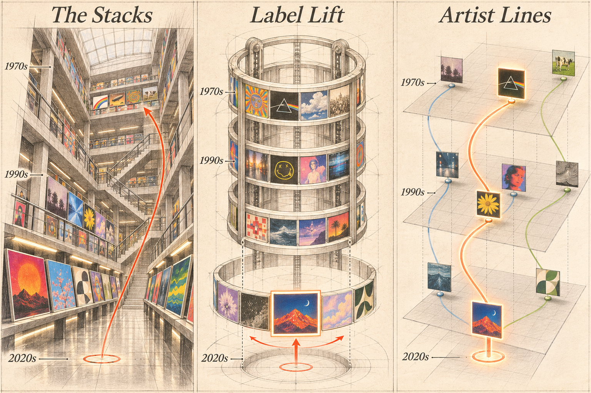

# Sleeve’s first spatial release

The opening camera rests at cover height beside the newest dated release in the selected library. Ascend to go back in release time. Unknown years have their own signed bay accessible from the entrance. New acquisitions from 1978 belong upstairs with 1978. All three studies use this convention.

## Three ways into the same collection

| Study | What moving means | Best listening question | Main design risk |
| --- | --- | --- | --- |
| The Stacks | Rise between decade galleries, move sideways between labelled bays, approach a cover to read the jacket. A fixed year rail doubles as an express lift. | Which ’90s Warp sleeve am I picturing? | Long walls make rare imprints hard to find. Label search should land at the exact bay. |
| Label Lift | Turn a cylinder to face an imprint, then ride vertically through its releases. A cutaway reveals the years that imprint is present. | How did my ECM collection change from the ’70s to the ’90s? | Hundreds of labels cannot fit legibly around a ring. Pin a handful and use a searchable index to swap one in. |
| Artist Lines | Trace an artist’s releases across time. Select one stop to reveal a few connections to owned albums, with the evidence written beside each branch. | Where can I go from this artist, and what connects the records? | Dense intersections become unreadable. Expand just the selected stop and retain the route home. |

## Release sequence

Build The Stacks first. Its primary gesture works with the year Sleeve already decodes. Borrow the label lock from Label Lift and the single highlighted branch from Artist Lines. Keep all three designs available for review before committing to the room geometry.

1. **Get the camera right with the sample library.** Embed a GPU-rendered scene in the macOS SwiftUI window. Prototype a Metal-backed view with textured cover quads, a fixed horizon, and no passive drift. Use the six bundled albums for recognition and a dated fixture spanning several decades for travel. Vertical scroll travels through time, horizontal scroll moves along the gallery, and pinch changes viewing distance. Arrow keys move between stops, Return opens a record, and Escape restores the prior camera. Pass when the newest record is visible at rest, an older cover is reachable by gesture and keyboard, and a round trip lands on the same jacket.
2. **Give the real collection an address.** Feed the scene from the selected Plex section. Distant galleries show year markers and counts. Nearby bays load thumbnails on demand. Keep layout deterministic during a session. Validate the releasing imprint on known records before exposing label locks. Pass when the collector can jump to a known decade and imprint, open the correct edition, and recover from missing dates or labels. Check a section switch during refresh for stale covers and counts.
3. **Make a detour playable.** From the focused jacket, reveal up to three owned albums with a resolved Plex artist relationship or a verified shared imprint. Choosing a branch flies to its destination. Back retraces it. Use the existing album detail, transport, and AVPlayer queue. Pass when the listener can explain a connection, inspect the destination during playback, and return across a track boundary with the expected queue and focus.
4. **Prove the room works at scale.** Exercise a 10,000-album fixture and the real Plex library. Profile texture residency, frame times during flight, and warm filter latency on a named Mac. Proposed targets are 60 fps during warm traversal and p95 under 200 ms for warm filter updates. Give Reduce Motion direct cuts and provide a keyboard- and VoiceOver-accessible shelf with the same places and actions. Pass when the collector can complete the same find, play, detour, and return task in both presentations.

**First prototype decision.** Ask the listener to find an older record from the entrance without explaining the axes. Watch whether they look up, recognize a jacket before zooming, and can predict where Back will take them. That session determines camera distance and travel speed before work on a larger environment.

[Collection requirements and acceptance stories](../COLLECTION-DISCOVERY.md)
